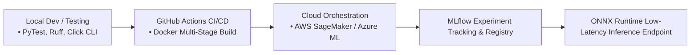

# 🚀 Duke University MLOps Specialization Study Hub & Code Repository

<div align="center">

### **🏆 Official 4-Course Specialization — 100% Grade Perfection**

[](https://www.coursera.org/account/accomplishments/specialization/I1THK805BQLF)
[](https://duke.edu/)
[](https://mlflow.org/)
[](https://aws.amazon.com/sagemaker/)
[](https://azure.microsoft.com/)
[](https://onnx.ai/)

**Learner:** Eng. Ahmed Rifai  
**Instructors:** Noah Gift & Alfredo Deza (Duke University / Pragmatic AI Labs)  
**License:** Kiron Open Higher Education Coursera License  
**Comprehensive Study Guide:** [📖 Read the Complete MLOps Study Guide](STUDY_GUIDE.md)

</div>

---

## 📌 Repository Overview

This repository serves as an operational study hub, production engineering reference, and code repository for the **MLOps Specialization by Duke University**. It documents enterprise machine learning operations spanning Python automation, CI/CD with GitHub Actions, containerization with Docker, cloud training & deployment on AWS SageMaker and Microsoft Azure ML, MLflow tracking and model registry, and ONNX runtime acceleration.

> [!NOTE]
> All binary credential certificates and verification proofs are officially archived in Google Drive and verified via official Coursera credential IDs. This repository focuses strictly on high-yield technical artifacts: structured coursework, reusable Python modules in `src/`, and MLOps study guides.

---

## 🏗️ MLOps Architecture Blueprint



---

## 📚 Curriculum & Course Breakdown

| # | Course Title | Score | Focus Areas | Official Verification |
|:---:|:---|:---:|:---|:---:|
| **01** | Python Essentials for MLOps | **100%** | Production CLI tools (`click`), PyTest, code coverage, CI/CD | [AH9DILW47Q84](https://www.coursera.org/account/accomplishments/verify/AH9DILW47Q84) |
| **02** | DevOps, DataOps, MLOps | **100%** | Kaizen continuous delivery, Docker multi-stage builds, DVC | [7ZZOFMSHCHUW](https://www.coursera.org/account/accomplishments/verify/7ZZOFMSHCHUW) |
| **03** | MLOps Platforms: Amazon SageMaker & Azure ML | **100%** | Cloud pipelines, Step Functions, managed online endpoints | [HBRGTRSHZXS9](https://www.coursera.org/account/accomplishments/verify/HBRGTRSHZXS9) |
| **04** | MLOps Tools: MLflow and Hugging Face | **100%** | MLflow tracking & registry, ONNX optimization, Hugging Face Hub | [WOBTC8F48LZH](https://www.coursera.org/account/accomplishments/verify/WOBTC8F48LZH) |
| 🎓 | **Full Specialization Credential** | **100%** | **Duke University MLOps Master Credential** | [I1THK805BQLF](https://www.coursera.org/account/accomplishments/specialization/I1THK805BQLF) |

---

## 📂 Repository Structure

```text
├── STUDY_GUIDE.md                     # Comprehensive theoretical & platform study guide
├── README.md                          # Repository overview & verification index
├── .gitignore                         # Excludes cache, model runs & certificate binaries
├── src/
│   └── mlops_duke/
│       ├── __init__.py                # Package initialization
│       ├── model_registry.py          # MLflow tracking & metadata manager
│       └── onnx_runtime_helper.py     # ONNX runtime optimization & validation engine
```

---

## 🚀 Quickstart & MLOps Toolkit

### Installation
```bash
git clone https://github.com/Eng-Ahmed-Rifai/MLOps-Specialization-Duke.git
cd MLOps-Specialization-Duke
python -m venv .venv
source .venv/bin/activate  # On Windows: .venv\Scripts\activate
pip install mlflow onnx onnxruntime pytest
```

### 1. MLflow Metadata Tracker
```python
from mlops_duke.model_registry import MLflowTracker

tracker = MLflowTracker(experiment_name="concrete_crack_resnet")
run_meta = tracker.format_run_metadata(
    params={"lr": 0.001, "batch_size": 32, "epochs": 10},
    metrics={"val_loss": 0.042, "val_acc": 0.998}
)
print(run_meta)
```

---

## 👤 Author
**Eng. Ahmed Rifai**  
*AI & Computer Vision Engineer*  
GitHub: [@Eng-Ahmed-Rifai](https://github.com/Eng-Ahmed-Rifai)
